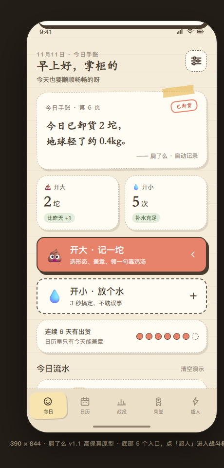
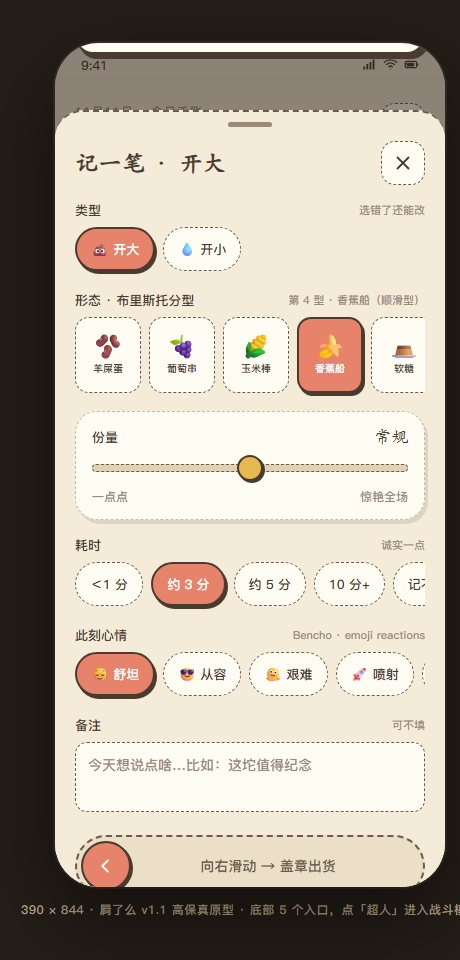
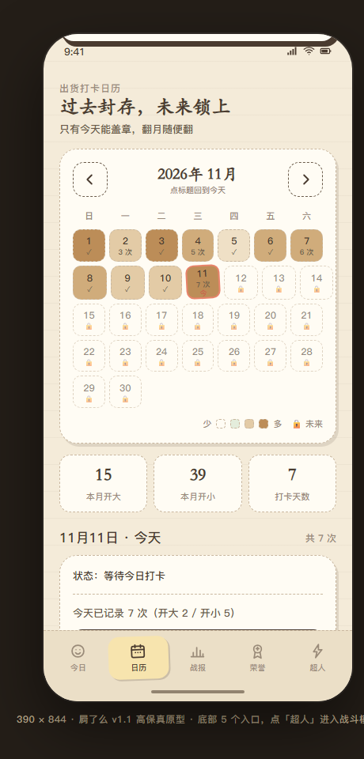
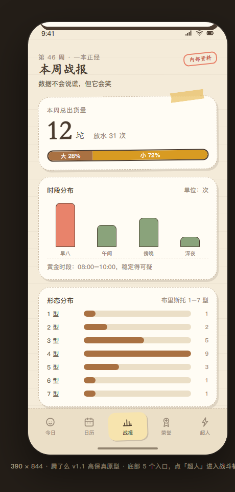
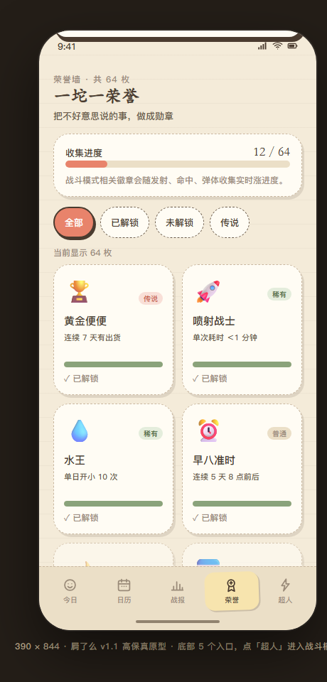
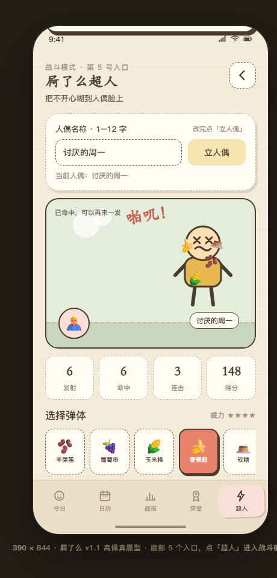

<div align="center">

# 💩 屙了么

**每日出货记录 · 一本正经地记录，不太正经地开心**

一款 Android 端的每日大便 / 小便记录应用，附赠「屙了么超人」战斗模式小游戏。

   

</div>


> 上面是**高保真原型的真实界面截图**，不是设计稿渲染图。所有文案、配色、徽章、动画状态均来自实际可运行的页面。

---

## 这是个什么项目

记录每天「开大 / 开小」这件事，本来可以很枯燥。所以这个项目把它做成了一本**手账涂鸦风的厕所日报**：盖印章、集徽章、看战报、攒连续天数，还有一款把不开心糊到人偶脸上的小游戏。

- 🎨 **纸感手账涂鸦**：暖白纸底、虚线描边、贴纸硬阴影、胶带装饰、手绘线条图标
- 😄 **全程中文毒鸡汤**：从「地球轻了 0.2kg，辛苦了」到「伤害不高，但侮辱性极强」
- 📴 **零权限、纯本地**：不联网、不上传、无账号、无第三方统计或广告 SDK
- 🧩 **双份产物**：一份可直接用浏览器打开的可点击原型，一份 Android Studio 可直接打开的 Compose 工程

---

## 界面一览

| 今日 · 记录首页 | 记一笔 · 布里斯托 7 型 |
| :---: | :---: |
|  |  |
| **日历 · 跨月打卡** | **战报 · 本周业态分析** |
|  |  |
| **荣誉 · 64 枚徽章** | **超人 · 战斗模式** |
|  |  |

---

## 功能

### 📒 今日与记录
- 「开大 · 记一坨」「开小 · 放个水」双主按钮，最小高度 64dp，按压缩放反馈
- 布里斯托 7 型选择、份量滑杆、耗时、五种心情、备注
- **滑动确认盖章**（Slide to Confirm）、彩纸粒子、Toast 播报、今日流水、空态与摇一摇彩蛋

### 🗓️ 日历打卡
- 用 `LocalDate` / `YearMonth` 实现**跨月、跨年**翻页，点月份标题回到今天
- **未来日期**显示锁定，禁止提前打卡；**历史日期**只读封存，不能补卡、修改或删除
- **仅今天**可盖章，且一天只盖一次；本月开大 / 开小 / 打卡天数统计

### 📊 战报与荣誉
- 周热力图、形态分布比例、加载态与重新召集
- **64 枚徽章**，分普通 / 稀有 / 史诗 / 传说四档，支持全部 / 已解锁 / 未解锁 / 传说四种筛选
- 3 枚战斗徽章按累计战绩动态结算并发射进度：发射 10 次、命中 20 次、用满 7 种弹体

### 🦸 屙了么超人（战斗模式）
- 底部第 5 个入口，独立页面，进入前记住来源页、返回时原路跳回
- 自定义人偶名称并校验：非空、≤12 字、禁止换行 / 制表符、禁止 `<` `>`
- 7 种弹体（羊屎蛋 / 葡萄串 / 玉米棒 / 香蕉船 / 软糖 / 泥浆 / 纯液体），各有威力、吐槽与飞行轨迹
- 飞行动画、旋转弹体、命中粒子、挂彩、「啪叽！」文案、人偶变脸、连击与得分
- 可无限重复发射；**重置只清本局**，累计战绩保留给荣誉墙

---

## 🎨 设计系统 · C 手账涂鸦

| 用途 | 色值 | 用途 | 色值 |
| :--- | :--- | :--- | :--- |
| 纸底 | `#F4EBD9` | 卡片白 | `#FFFCF4` |
| 墨棕 | `#4A3B2F` | 印章红 | `#E8836B` |
| 草绿 | `#8AA37B` | 胶带黄 | `#E6B84F` |
| 大便棕 | `#A97142` | 小便金 | `#D89B22` |
| 虚线灰 | `#C9B79F` | 弹体薄荷 | `#5FA98B` |

**组件规范**：卡片圆角 22dp／按钮 16dp，虚线描边 1.5–2dp + 实色硬阴影（4×5dp）营造贴纸感，按钮最小高度 64dp、触控热区 ≥44dp、按压缩放 0.97、交互动画 ≤300ms。色板与尺寸在 `android/.../ui/theme/` 下集中定义，原型侧对应 `:root` CSS 变量，两端共用同一套 token。

**组件灵感来源**：[HeroUI](https://heroui.com/) 的按钮变体与语义色骨架、[Watermelon UI](https://ui.watermelon.sh/) 的变形按钮 / Knob Slider / Tabs、[Bencho](https://bencho.dev/) 的彩纸 Particles / Slide to Confirm / Emoji Reactions / Toast Stack。

---

## 🛠 技术栈

| 项目 | 版本 / 说明 |
| :--- | :--- |
| 语言 | Kotlin 2.0.21（含 Compose Compiler Plugin） |
| UI | Jetpack Compose + Material 3，BOM `2024.10.01` |
| 构建 | Gradle 8.9 · Android Gradle Plugin 8.7.3 |
| SDK | `compileSdk` / `targetSdk` 34，`minSdk` 26（Android 8.0+） |
| 架构 | 单 Activity + Compose 状态驱动，纯规则层 `data/GameRules.kt` |
| 持久化 | `SharedPreferences` + `org.json`，无数据库、无网络 |
| 原型 | 单文件 HTML + 内联 CSS / JS / SVG，`localStorage` 持久化 |

---

## 📁 目录结构

```
.
├── README.md
├── .gitignore                     # 排除本机路径、密钥、构建产物
├── docs/
│   └── screenshots/               # 本页配图（原型实拍 PNG）
├── prototype/
│   └── index.html                 # 单文件高保真可点击原型
└── android/                       # Android Studio 直接打开此目录
    ├── settings.gradle.kts
    ├── build.gradle.kts
    ├── gradle.properties
    ├── gradlew / gradlew.bat
    ├── gradle/wrapper/
    └── app/
        ├── build.gradle.kts
        └── src/main/
            ├── AndroidManifest.xml
            ├── java/com/eliamo/app/
            │   ├── MainActivity.kt
            │   ├── data/           # Models / GameRules / FakeData / RecordStore
            │   └── ui/             # theme / icons / components / screens / AppRoot
            └── res/                # values / drawable
```

---

## 🚀 快速开始

### 1. 先看原型（零依赖）

直接用浏览器打开 `prototype/index.html` 即可，无需安装任何东西。建议把窗口拉到 460px 以上宽，或直接开浏览器设备模拟器。

### 2. 用 Android Studio 运行

1. Android Studio 里选择 **Open**，指向仓库的 `android/` 目录
2. 等待 Gradle 同步完成后，连接设备或启动模拟器，点 Run

### 3. 命令行构建

```bash
cd android
./gradlew assembleDebug        # macOS / Linux
gradlew.bat assembleDebug      # Windows
```

产物在 `android/app/build/outputs/apk/debug/app-debug.apk`。

> **关于 `local.properties`**：该文件记录本机 Android SDK 路径，属于本机环境配置，已被 `.gitignore` 排除，**不包含在仓库中**。首次构建时由 Android Studio 自动生成；若用命令行，请自行新建 `android/local.properties` 并写入 `sdk.dir=<你的 Android SDK 目录>`。
>
> `gradle.properties` 中的 `android.overridePathCheck=true` 用于允许本地检出路径含非 ASCII 字符，构建时会有一行 experimental 警告，属预期现象。仓库源默认配置了阿里云镜像加速，可根据网络环境自行调整 `settings.gradle.kts`。

---

## 🔒 隐私与数据

- `AndroidManifest.xml` **未声明任何权限**，包括 `INTERNET`——应用没有联网能力
- Android 端数据仅存于本机 `SharedPreferences`；原型数据仅存于浏览器 `localStorage`
- 无账号体系、无云端同步、无埋点、无广告、无第三方 SDK
- 仓库内不含 `local.properties`、签名密钥、令牌、本机绝对路径或本地工具会话数据

---

## 📦 版本与发布

**v1.1.0** · 底部第 5 入口「屙了么超人」战斗模式、跨月打卡日历（未来锁定 / 历史只读 / 今日一次）、64 枚荣誉徽章与动态进度。

Release 提供两个资产：

| 资产 | 说明 |
| :--- | :--- |
| `eliaome-v1.1.0-debug.apk` | 可直接安装到 Android 8.0+ 设备的 debug 包 |
| `eliaome-v1.1.0-source.zip` | 仅含核心源码与文档的离线源码包 |

本版本已通过 `gradlew clean assembleDebug` 从零构建验证，原型内联 JS 亦通过语法检查。

---

## ⚠️ 免责声明

本项目为**娱乐 / 设计演示用途**。布里斯托大便分类、份量与耗时等字段仅作趣味记录，不构成任何医疗建议或诊断依据；身体不适请及时就医。应用内的「战报」「导出」等演示数据均为本地模拟，不代表真实统计结果。

---

## 📄 许可

本仓库暂未指定开源许可证，默认保留所有权利。如需以开源方式使用，请联系仓库所有者。

---

<div align="center">

**祝你每天都顺顺畅畅的呀。** 🧻

</div>
